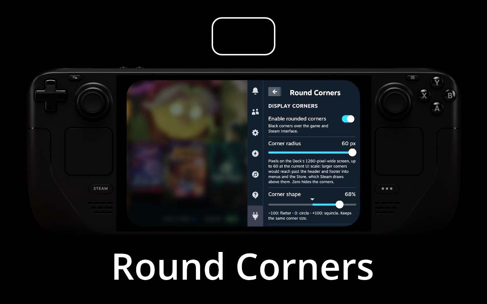

# Round Corners - a Decky plugin

Rounds the corners of the Steam Deck screen in Gaming Mode, with adjustable
corner size and curvature.
A per-game 16:9 toggle moves the corners to the picture's edges in 16:9-only games.

## Installing on Steam Deck

1. Download the ZIP from the [latest release](https://github.com/Vivoxti/DeckyRoundCorners/releases/latest)
   and copy it to the Deck, for example to Downloads.
2. In Gaming Mode, open Decky → Settings → General and turn on Developer mode.
3. Open Developer → Install Plugin from ZIP File and choose the archive.
4. Open Round Corners, turn on Enable rounded corners and adjust Corner radius.
5. Close the Decky menu and check the effect in a game.

## Limitations

- The maximum radius keeps the corners within Steam's header and footer, so
  menus and the Store, which Steam draws above the corners, never cut into them.
- The plugin uses an internal Steam hook that may change in a Steam update.
  If the hook is not found, the panel shows a message and the effect stays off.
- Over games, the corners follow Steam's internal focus and composition
  state. If a Steam update changes it, the plugin keeps Notification
  composition requested all the time, as version 1.0.0 did, and 16:9 game mode
  stays off.

## How it works

- Four small static images over Steam's interface, all drawn from one
  antialiased texture (14 KiB at radius 60). It is regenerated only
  when you change the size or shape.
- No backend, no per-frame code, no polling. Touch and buttons pass through
  the corners.
- Steam's interface shows the corners by itself everywhere except over an
  uncovered game. Only there, after Steam's own interface has hidden and a
  0.4 s wait for Steam's closing animations, the plugin requests Steam's
  Notification composition. That keeps the corners visible without taking
  input. Steam's menus open and close exactly as without the plugin.
- Corners fade in and out with a 0.4 s CSS opacity transition. The top-left
  corner also steps aside for Steam's volume popin while it is shown.

## Performance

Measured on a Steam Deck with corners on and off:

- Light game: power draw, GPU, CPU, Steam and Gamescope load unchanged
  (difference within the ±0.06 W measurement noise).
- Heavy game: same FPS.

## References

- [Decky template](https://github.com/SteamDeckHomebrew/decky-plugin-template):
  the official plugin build format and API.
